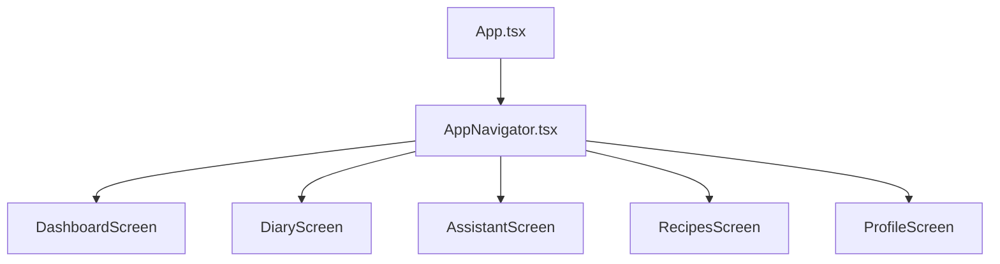
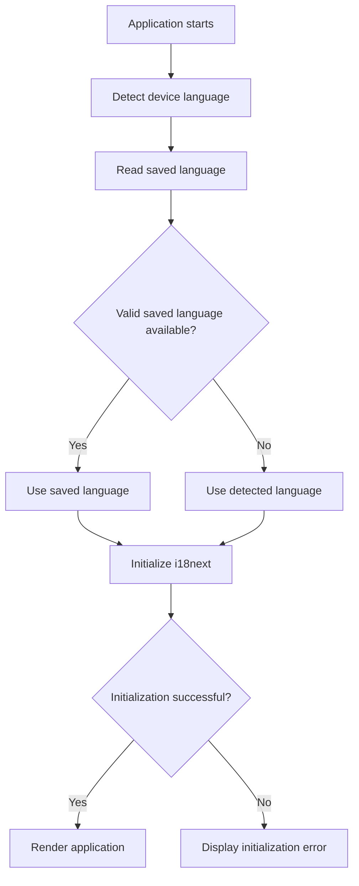

# Mobile Architecture

## Overview

The SlowBuilder mobile application follows a modular architecture designed to promote maintainability, scalability, separation of concerns and code reusability.

The application is built using React Native, Expo and TypeScript.

## Directory Structure

```text
mobile/
├── assets/
├── src/
│   ├── components/
│   ├── context/
│   ├── hooks/
│   ├── i18n/
│   │   ├── locales/
│   │   │   ├── en.json
│   │   │   └── es.json
│   │   ├── index.ts
│   │   └── languageStorage.ts
│   ├── navigation/
│   │   └── AppNavigator.tsx
│   ├── screens/
│   │   ├── WelcomeScreen.tsx
│   │   ├── DashboardScreen.tsx
│   │   ├── DiaryScreen.tsx
│   │   ├── AssistantScreen.tsx
│   │   ├── RecipesScreen.tsx
│   │   └── ProfileScreen.tsx
│   ├── services/
│   ├── theme/
│   ├── types/
│   │   └── navigation.ts
│   └── utils/
├── App.tsx
├── index.ts
└── package.json
```

## Directory Responsibilities

| Directory | Responsibility |
|---|---|
| components | Reusable user interface components. |
| context | Shared application state. |
| hooks | Reusable React logic and custom hooks. |
| i18n | Internationalization and translation resources. |
| navigation | Navigation configuration and screen transitions. |
| screens | Application screens and their composition. |
| services | Communication with backend services and external APIs. |
| theme | Design tokens, colors, typography and spacing. |
| types | TypeScript interfaces and type definitions. |
| utils | Reusable utility functions. |
| assets | Images, icons and static resources. |

## Application Entry Point

The `App.tsx` file acts as the root component of the mobile application.

Its responsibility is to initialize global configuration, providers and navigation rather than contain complete screen implementations.

The current entry point initializes internationalization before rendering the main navigation.

During initialization, a loading indicator is displayed. If initialization fails, an error message is presented.

## Architectural Principles

- Separation of concerns.
- Reusable components.
- Type safety.
- Modular development.
- Consistent naming conventions.
- Centralized design tokens.
- Internationalization support.
- Separation between presentation and business logic.

## Naming Conventions

- Components and screens: PascalCase.
- Functions and variables: camelCase.
- Custom hooks: camelCase with the `use` prefix.
- Directories: lowercase.
- Source code and technical documentation: English.

## Current Implementation

The current implementation establishes the technical foundation of SlowBuilder.

Implemented functionality:

- React Native and Expo development environment.
- TypeScript configuration.
- Modular mobile project structure.
- Separation of screen components and application initialization.
- Bottom tab navigation with five primary screens.
- Strongly typed navigation routes.
- Active and inactive navigation icons using Ionicons.
- English and Spanish internationalization.
- Automatic device language detection.
- Manual language selection from the profile screen.
- Persistent language preferences using AsyncStorage.
- Loading and error states during application initialization.

The main screens currently contain provisional content, except for the language settings functionality implemented in the profile screen.

The welcome screen is preserved for potential future use but is not part of the current navigation flow.

Empty directories are preserved using `.gitkeep` files until their respective functionality is implemented.

The visual identity and design system remain provisional.

## Navigation Architecture

SlowBuilder uses React Navigation to manage screen transitions and application navigation.

The current implementation uses a Bottom Tab Navigator with five primary screens.

| Route | Screen | Intended Responsibility |
|---|---|---|
| Dashboard | DashboardScreen | Daily nutritional overview. |
| Diary | DiaryScreen | Meal registration and nutritional history. |
| Assistant | AssistantScreen | AI-powered nutritional assistant. |
| Recipes | RecipesScreen | Saved recipes and meal management. |
| Profile | ProfileScreen | User settings and nutritional goals. |

### Navigation Flow



### Type Safety

Navigation routes are defined using `RootTabParamList` in `src/types/navigation.ts`.

This provides compile-time validation of route names and navigation parameters.

### Navigation Dependencies

- `@react-navigation/native`
- `@react-navigation/bottom-tabs`
- `react-native-screens`
- `react-native-safe-area-context`
- `@expo/vector-icons`
- `expo-font`

### Navigation Icons

Ionicons provides active and inactive icons for each tab.

Icon definitions are centralized in a strongly typed configuration object to ensure that every navigation route has a corresponding icon.

### Design Decisions

- Bottom tab navigation provides direct access to the five primary sections.
- Navigation configuration is separated from individual screen components.
- Route identifiers remain independent of displayed translations.
- Native Stack Navigation will be introduced when secondary screens are required.
- The current visual styling is provisional.

## Internationalization (i18n)

SlowBuilder supports English and Spanish through i18next and react-i18next.

Translation resources are bundled locally, allowing the application interface to operate in both languages without an internet connection.

### Directory Structure

```text
src/i18n/
├── locales/
│   ├── en.json
│   └── es.json
├── index.ts
└── languageStorage.ts
```

### Dependencies

- `i18next`: translation engine.
- `react-i18next`: React integration.
- `expo-localization`: device language detection.
- `@react-native-async-storage/async-storage`: persistent language preferences.

### Language Initialization



The application initially detects the device language.

A valid saved language preference takes priority over the detected language.

Spanish is selected for Spanish device locales. English is used for other device languages.

### Language Persistence

User language preferences are stored locally using AsyncStorage under the key `@slowbuilder/language`.

The supported language codes are `en` and `es`.

Users can change their preferred language from the profile screen.

Navigation labels and screen content update dynamically without restarting the application.

### Design Decisions

- English is the fallback language.
- Translation resources are separated from application components.
- Navigation route identifiers remain language-independent.
- User-facing text should use translation keys instead of hardcoded strings.
- Language preferences are stored locally.
- The application waits for internationalization initialization before rendering the main navigation.
- Initialization and storage errors are handled explicitly.

### Adding New Translations

When implementing a new feature, translation keys must be added to both English and Spanish resource files.

Both translation files should maintain matching key structures.

Components access translations through the `useTranslation` hook.

Example:

```tsx
const { t } = useTranslation();

<Text>{t('screens.dashboard')}</Text>
```

## Future Evolution

The architecture will progressively incorporate:

- Centralized design system and theming.
- Nutritional data models.
- Calorie and macronutrient calculations.
- Reusable nutrition tracking components.
- Application state management.
- Manual food and meal registration.
- Native Stack Navigation for secondary screens.
- User authentication.
- Backend API integration.
- Persistent nutritional data.
- Recipe management.
- AI-powered nutritional assistance.
- Automated testing.

Architectural decisions will be reviewed as the application grows.

## Related Issues

- #9 — Configure mobile project structure.
- #10 — Set up React Navigation.
- #11 — Configure internationalization (i18n).
