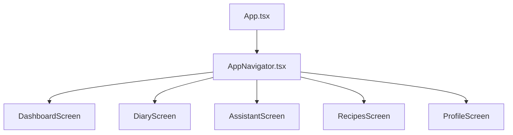

# Mobile Architecture

## Overview

The SlowBuilder mobile application follows a modular, layered architecture designed to promote maintainability, scalability, separation of concerns and code reusability.

The application is built using React Native, Expo and TypeScript.

## Directory Structure

```text
mobile/
├── assets/
├── src/
│   ├── components/
│   ├── context/
│   ├── hooks/
│   ├── i18n/
│   ├── navigation/
│   ├── screens/
│   ├── services/
│   ├── theme/
│   ├── types/
│   └── utils/
├── App.tsx
├── index.ts
└── package.json
```

## Directory Responsibilities

| Directory | Responsibility |
|---|---|
| components | Reusable user interface components. |
| context | Shared application state. |
| hooks | Reusable React logic and custom hooks. |
| i18n | Internationalization and translation resources. |
| navigation | Navigation configuration and screen transitions. |
| screens | Application screens and their composition. |
| services | Communication with backend services and external APIs. |
| theme | Design tokens, colors, typography and spacing. |
| types | TypeScript interfaces and type definitions. |
| utils | Reusable utility functions. |
| assets | Images, icons and static resources. |

## Application Entry Point

The App.tsx file acts as the root component of the mobile application.

Its responsibility is to initialize global configuration, providers and navigation rather than contain complete screen implementations.

## Architectural Principles

- Separation of concerns.
- Reusable components.
- Type safety.
- Modular development.
- Consistent naming conventions.
- Centralized design tokens.
- Internationalization support.
- Separation between presentation and business logic.

## Naming Conventions

- Components and screens: PascalCase.
- Functions and variables: camelCase.
- Custom hooks: camelCase with the use prefix.
- Directories: lowercase.
- Source code and technical documentation: English.

## Current Implementation

## Navigation Architecture

SlowBuilder uses React Navigation to manage screen transitions and application navigation.

The current implementation uses a Bottom Tab Navigator with five primary screens.

| Route | Screen | Responsibility |
|---|---|---|
| Dashboard | DashboardScreen | Daily nutritional overview. |
| Diary | DiaryScreen | Meal registration and nutritional history. |
| Assistant | AssistantScreen | AI-powered nutritional assistant. |
| Recipes | RecipesScreen | Saved recipes and meal management. |
| Profile | ProfileScreen | User settings and nutritional goals. |

### Navigation Flow



### Type Safety

Navigation routes are defined using RootTabParamList in src/types/navigation.ts.

This provides compile-time validation of route names and navigation parameters.

### Navigation Dependencies

- @react-navigation/native
- @react-navigation/bottom-tabs
- react-native-screens
- react-native-safe-area-context
- @expo/vector-icons
- expo-font

### Navigation Icons

Ionicons provides active and inactive icons for each tab.

Icon definitions are centralized in a strongly typed configuration object to ensure that every navigation route has a corresponding icon.

### Design Decisions

- Bottom tab navigation provides direct access to the five primary sections.
- Navigation configuration is separated from individual screen components.
- Route identifiers remain independent of displayed translations.
- Native Stack Navigation will be introduced when secondary screens are required.
- The current visual styling is provisional.

### Related Issue

#10 — Set up React Navigation.

## Future Evolution

The architecture will progressively incorporate navigation, internationalization, nutritional tracking, authentication, API integration, recipe management and AI-powered features.

Architectural decisions will be reviewed as the application grows.

## Related Issue

#9 — Configure mobile project structure.