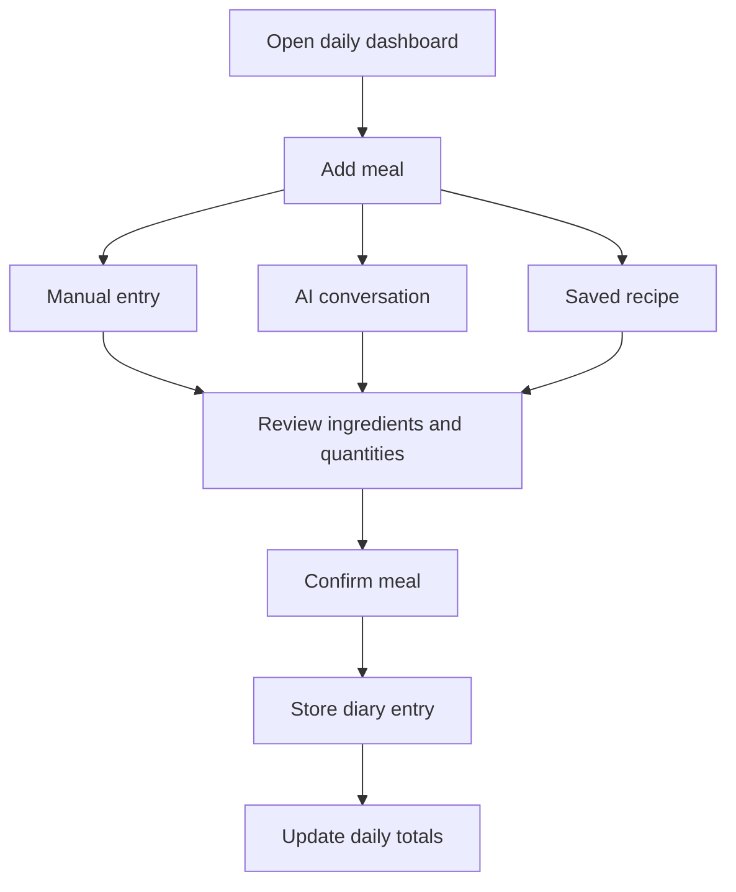
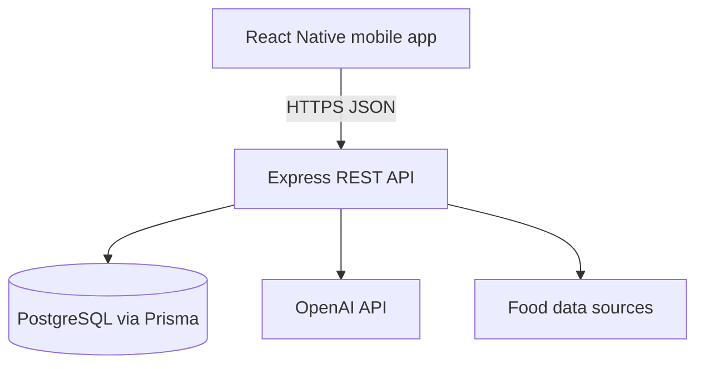

# Project overview

Status: MVP scope agreed — 2026-11-27

## Vision

SlowBuilder helps people build sustainable nutrition habits day by day. It reduces the friction of food logging while giving users a clear view of their calorie and protein goals. The long-term vision includes training, shopping and progress tracking without making those features prerequisites for the first release.

## Problem and audience

Manual food logging is repetitive, particularly for frequently prepared meals. Users need an easy way to describe meals, review nutritional estimates, reuse recipes and track progress. The MVP targets adults with personal accounts who want to lose fat, maintain weight or gain muscle.

## Scope

The MVP includes the dashboard, manual diary, history and weekly summaries, recipe management, conversational AI, account management, manual and calculated goals, default and custom meal categories, and Spanish/English localization. Users provide weight, height, age, sex (with an explanation of its use in estimation) and activity level when requesting calculated goals. Manual goals remain available without those inputs.

Recipe records contain ingredients, quantities and individual nutrient values; cooking instructions are not required. Food photographs, barcode scanning, shopping lists, training, wearable integration and body measurements are deferred.

## Main workflow

## Proposed architecture

The backend validates inputs, performs deterministic nutrient calculations, authorizes access and handles external services. AI interprets natural language, asks for missing quantities and supplies labeled estimates only when appropriate. It does not silently write diary entries. API credentials remain on the server.

## Data principles

Food records store nutrient values per reference quantity and source. Recipe ingredients link quantities to foods; diary items preserve historical nutrient snapshots so later changes to recipes or foods do not rewrite previous days. Goals should be effective-dated to preserve historical context. Dates are interpreted using the user's local timezone. Exact database schema and API contracts will be designed in later phases.

## Success criteria

An adult user can create an account, choose a goal, record a meal manually or with AI, correct the estimate, save a recipe, reuse it and see accurate daily totals in either supported language. Data persists across app restarts and is isolated by account.

## Open decisions

Brand colors, typography, logo, trademark clearance, license, hosting, authentication provider, exact nutrition formulas, data provider licensing and retention periods remain open. No production deployment or legal clearance is implied by this document.
